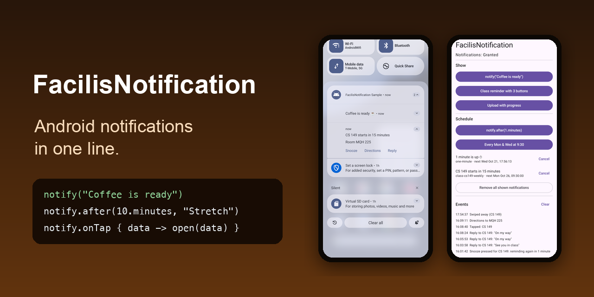

# FacilisNotification

[](https://jitpack.io/#al3j4ndrolm/FacilisNotification)
[](https://github.com/al3j4ndrolm/FacilisNotification/actions/workflows/build.yml)
[](LICENSE)

**Android notifications in one line.** No channels, no `PendingIntent`s, no receivers, no AlarmManager.

<p align="center">
  
</p>

Part of the Facilis family, with [FacilisCam](https://github.com/al3j4ndrolm/FacilisCam), [FacilisStorage](https://github.com/al3j4ndrolm/FacilisStorage) and [FacilisPermission](https://github.com/al3j4ndrolm/FacilisPermission).

```kotlin
notify("Coffee is ready ☕")

notify.after(10.minutes, "Time to stretch")
```

Works from an Activity, a ViewModel or background work. No `Context`, no `init()`. The Android 13+ permission is asked for you the first time.

## Buttons and taps

```kotlin
notify(
    title = "CS 149 starts in 15 minutes",
    text = "Room MQH 225",
    data = mapOf("classId" to "cs149"),
    actions = listOf(
        Action("Snooze"),                          // silent: runs in the background
        Action("Directions", opensApp = true),     // opens your app
        Action("Reply", input = "Message"),        // text box
    ),
)
```

```kotlin
// Application.onCreate: silent buttons run here, even when the app is closed
notify.onAction("Snooze") { data -> notify.after(10.minutes, "Class soon", data = data) }
notify.onReply("Reply") { data, text -> send(data["classId"], text) }

// Your screen: taps and app-opening buttons
notify.onTap { data -> openClass(data["classId"]) }
notify.onAction("Directions") { data -> openMap(data["classId"]) }
```

Each notification hands its own `data` back to the handler. Handlers are matched by name, so they keep working after Android closes your app.

## Schedule

```kotlin
notify.after(15.minutes, "Leave for class")
notify.at(LocalTime.of(9, 0), "Daily check-in")                 // today, or tomorrow if passed
notify.every(at = LocalTime.of(9, 30), days = setOf(MONDAY, WEDNESDAY), title = "CS 149 soon", key = "cs149")
notify.every(2.hours, "Drink water")

notify.cancelScheduled("cs149")
notify.scheduled()   // what's coming up
```

Scheduled notifications survive app restarts, reboots and time-zone changes. Use a `key` for repeating ones: scheduling the same key again replaces it instead of adding a duplicate.

## Progress

```kotlin
val upload = notify.progress("Uploading photo…")
upload.progress = 0.5f
upload.done("Photo uploaded ✓")        // or upload.fail("Upload failed", retry = Action("Retry"))
```

## Update and remove

Most notifications clean themselves up: they disappear when tapped, swiped or when a button is pressed. When you need control:

```kotlin
val n = notify("Ale sent you a photo", key = "chat-42")
n.update(text = "2 new photos")
n.cancel()

notify("New message", key = "chat-42")   // same key: replaces it instead of stacking
notify.cancel("chat-42")                 // works after a restart too
notify.cancelAll()
```

## Options

| Parameter | |
|---|---|
| `text` | Second line, expandable |
| `data` | Small key/value pairs handed back to your handlers (store ids, not objects) |
| `actions` | Up to 3 buttons |
| `channel` | Category users see in Settings, created from the name (default "General") |
| `image` | A picture `Uri`, shown when expanded |
| `key` | Name to replace or cancel it later |
| `timeout` | Remove it automatically after a `Duration` |
| `ongoing` | The user can't swipe it away |

The small icon is your app's `R.drawable.ic_notification` if you have one, otherwise a bell.

## Install

Add JitPack to `settings.gradle.kts`:

```kotlin
dependencyResolutionManagement {
    repositories {
        google()
        mavenCentral()
        maven("https://jitpack.io")
    }
}
```

Then (min SDK 26):

```kotlin
implementation("com.github.al3j4ndrolm:FacilisNotification:1.0.0")
```

No manifest changes: the notification permission, receivers and reboot handling are merged in for you.

## Good to know

- **Timing:** scheduled notifications show within about 10 minutes of their time, with no special permission. Pass `exact = true` for to-the-second timing; that needs the `SCHEDULE_EXACT_ALARM` permission, which Google Play only allows for alarm and calendar apps.
- **Replies:** after the user replies from a notification, Android keeps it on screen. FacilisNotification updates it to show the reply, without buttons, until the user swipes it away.
- **Permission:** if the user denies notifications, they're skipped (with a log warning). `notify.enabled` tells you, and `notify.requestPermission()` asks again.
- **Not included:** push notifications from a server (Firebase Cloud Messaging).

## Contributing

```bash
./gradlew :notification:testDebugUnitTest :notification:assembleRelease :sample:assembleDebug
```

`notification/` is the library and `sample/` a demo app that also uses FacilisPermission and FacilisStorage.

## License

[MIT](LICENSE)
